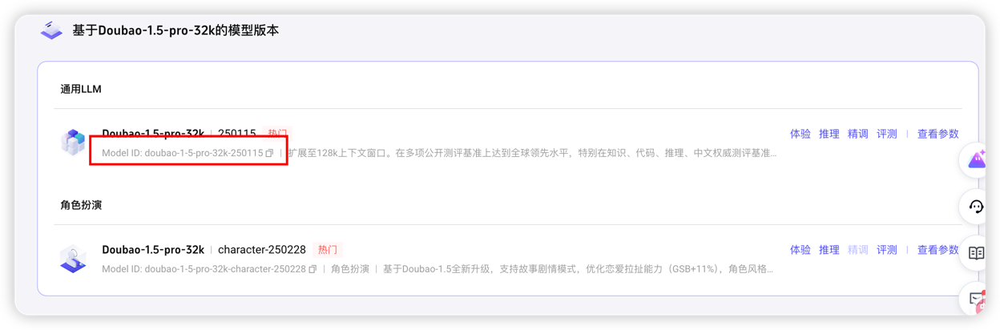
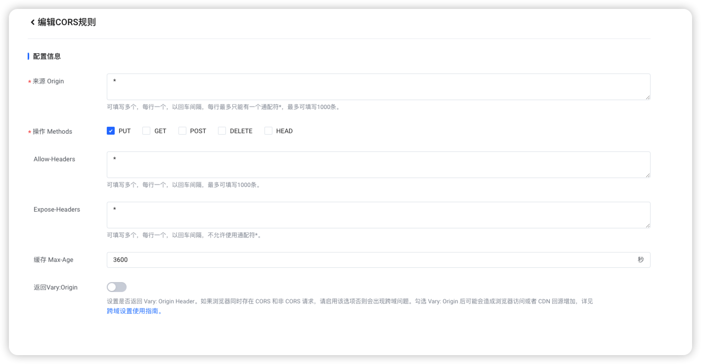
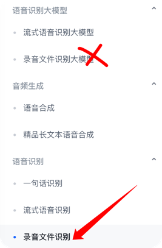
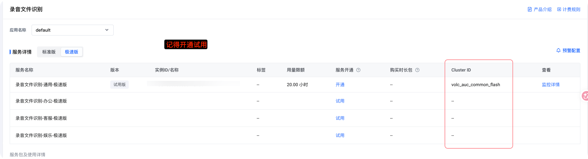

# 后端部署教程

在启动后端服务之前, 需要先安装好依赖, 并且申请字节 Tos 对象存储服务 以及 对应大模型的 API 调用权限

**注意 ⚠️： 请至少保证你本地的 Python 版本为 3.9 及以上, 否则可能会出现依赖无法安装, 项目启动失败等问题。**

## 1. 安装依赖
```bash
pip install -r requirements.txt
```

## 2. 配置环境变量(除了 WEB_ACCESS_PASSWORD 之外缺一不可)


```bash
export MODEL_ID=xxxx
export LLM_API_KEY=xxxx
export STORAGE_ACCESS_KEY=xxxx
export STORAGE_SECRET_KEY=xxxx
export STORAGE_ENDPOINT=xxxx
export STORAGE_REGION=xxxx
export STORAGE_BUCKET=xxxx
export AUC_API_KEY=xxxx
export AUC_RESOURCE_ID=volc.seedasr.auc
export WEB_ACCESS_PASSWORD=xxx
```
环境变量说明:

**WEB_ACCESS_PASSWORD**【选填】:前端访问后端服务的密码,后端指定之后需要在前端自定义设置-> 访问密码填写该密码才可以正常使用。

## 3. 启动服务
```bash
python app.py
```

## 在火山引擎获取对应的环境变量的值
主要分为三部分, 火山方舟/字节Tos/音频识别大模型

### 火山方舟
#### MODEL_ID

⚠️: 最新版本的 AI-Media2Doc 已经不再需要 ENDPOINT_ID, 由 MODEL_ID 代替。

登录[方舟控制台](https://console.volcengine.com/ark/region:ark+cn-beijing/openManagement?projectName=default)。进入开通管理, 选择开通一个大语言模型。
推荐使用 `doubao-1-5-pro-32k-250115` 。点击开通之后点击该大模型进入详情页，选择通用 LLM(没有就选主线模型), 复制红框内的 `模型 ID`，即为 `MODEL_ID` 的值。


<p>

</p>


#### ARK_API_KEY
在 API Key 管理中创建一个 API Key [参考文档](https://www.volcengine.com/docs/82379/1399008#_3-%E5%88%9B%E5%BB%BAAPIKey) 你就得到了 `ARK_API_KEY` 的值。

### S3对象存储服务, 以火山引擎为例，你可以选择其他兼容 S3 协议的对象存储服务商。
#### 创建 bucket 设置跨域规则
登录[对象存储控制台](https://console.volcengine.com/tos) 创建一个 bucket, 创建完毕之后进入该 bucket。点击右侧权限管理, 找到跨域访问设置, 新建一条跨域访问规则。
<p>

</p>
当然你也可以根据实际情况灵活选择。

#### STORAGE_ENDPOINT
需要使用 **S3 兼容域名**：`tos-s3-<region>.volces.com`（例如 `tos-s3-cn-beijing.volces.com`）。

❗️控制台概览页展示的 `tos-<region>.volces.com` 是 TOS 原生端点，它只接受 TOS 自己的签名，用 boto3 调会返回 `400 Bad Request`（`x-tos-ec: 0002-00000002`）。

不同区域的域名只把 `cn-beijing` 换成对应 region 即可。


#### STORAGE_BUCKET
`STORAGE_BUCKET` 的值就是你创建的 bucket 的名称。

#### STORAGE_REGION
`STORAGE_REGION` 的值就是你创建的 bucket 的区域, 例如 `cn-beijing`。


#### STORAGE_ACCESS_KEY 和 STORAGE_SECRET_KEY
进入 [IAM控制台](https://console.volcengine.com/iam/keymanage) 创建一个访问密钥,
你就得到了 `STORAGE_ACCESS_KEY` 和 `STORAGE_SECRET_KEY` 的值。


### 音频识别大模型

火山方舟每个音频识别大模型都提供了 20 个小时的试用额度, 可以轮流试用。

登录豆包语音控制台(https://console.volcengine.com/speech/app), 在**应用管理**创建应用并勾选**豆包录音文件识别模型2.0**，开通试用后在该应用下获取 **API Key**，即 `AUC_API_KEY`。

<p>

</p>


#### AUC_API_KEY
`AUC_API_KEY` 的值就是应用详情中的 API Key（新版控制台使用 API Key 鉴权，不再使用 APP ID + Access Token）。

#### AUC_RESOURCE_ID
模型资源 ID，`豆包录音文件识别模型2.0 标准版` 固定为 `volc.seedasr.auc`；如需换成 1.0 版本可填 `volc.bigasr.auc`。

<p>

</p>

### FAQ
- ❓:如何使用 ChatGPT, Claude, Gemini 等第三方大模型。
-  默认 LLM 的代码 Openai SDK。 因此你可以通过替换 `LLM_BASE_URL`, `LLM_API_KEY` 和 `MODEL_ID` 三个环境变量的值来使用其他大模型。


