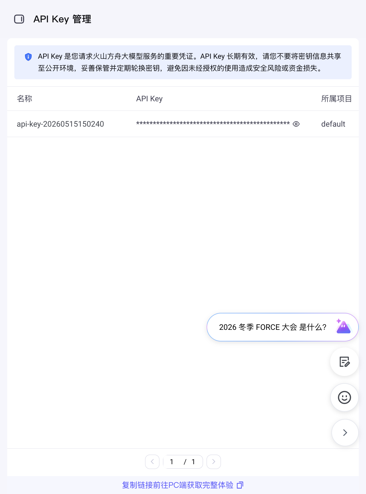
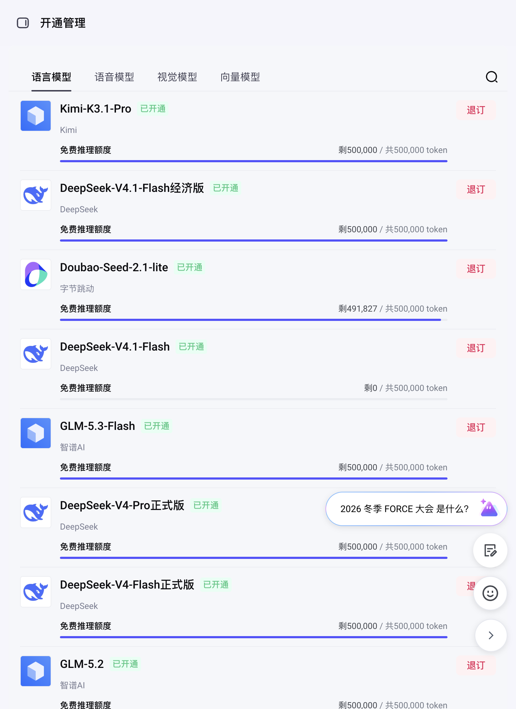
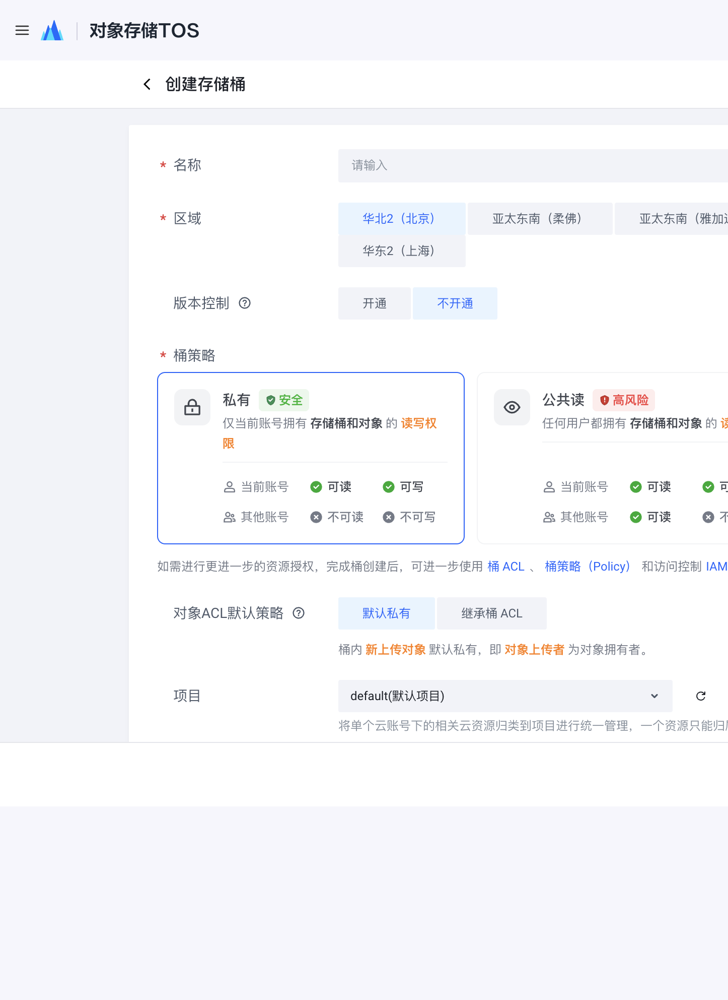
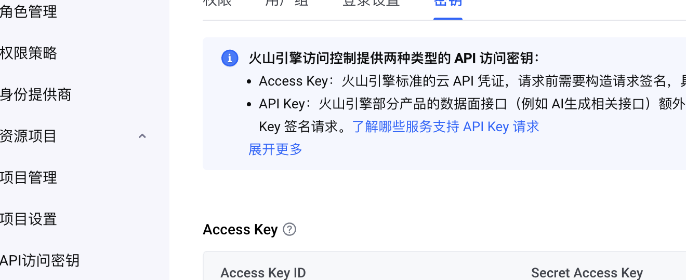
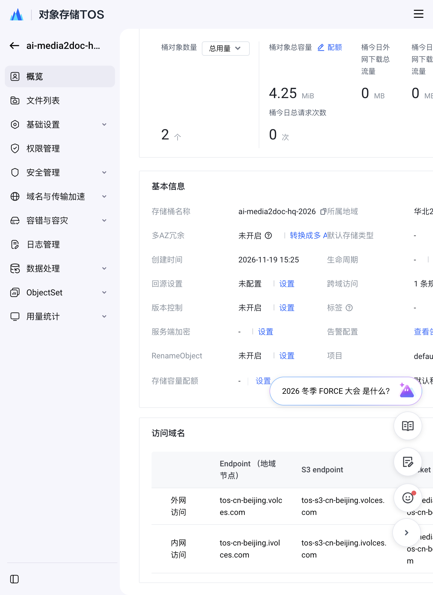
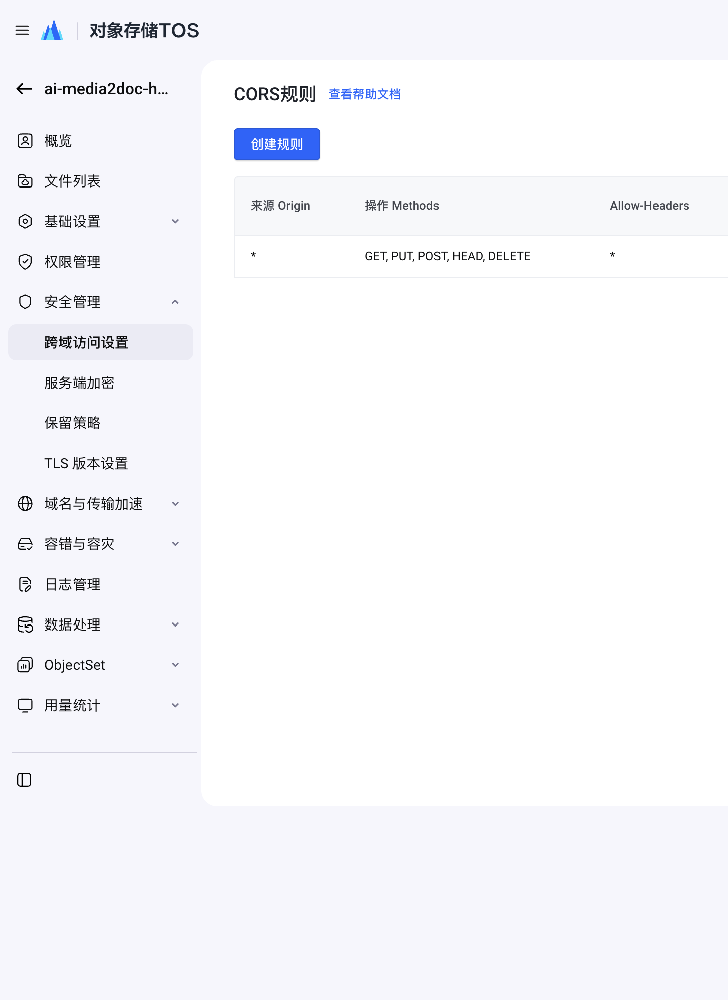
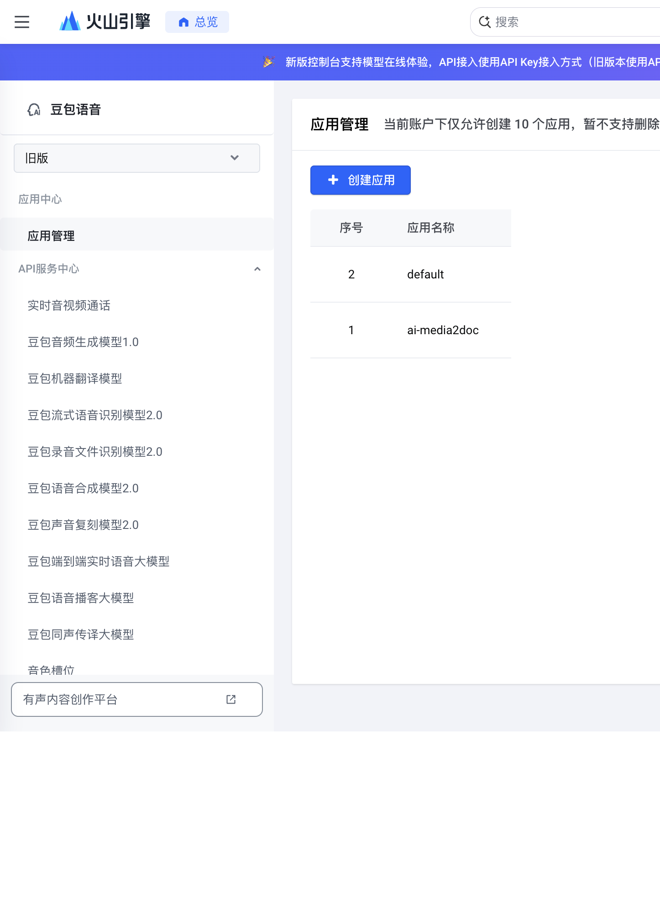
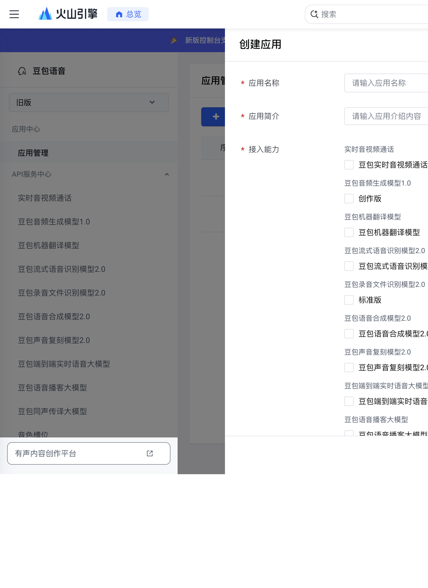

# AI-Media2Doc 本地部署配置 SOP（含踩坑实录）

> 适用版本：main @ dfcfc7b（FastAPI 0.104 + Vue3/Vite 6 后前端分离架构）
> 适用系统：macOS（Linux 命令基本一致）；Docker 部署请参考项目自带 docker-compose.yaml，本文覆盖**源码本地部署**路径。
> 文中所有"坑"均为真实踩坑记录，附了判别方法和修复命令。

---

## 0. 环境准备

| 组件 | 要求 | 检查命令 |
|---|---|---|
| Python | 3.10+（实测 3.12.13 可用，requirements 中的 pydantic 2.5 / fastapi 0.104 均有 3.12 wheel） | `python3 --version` |
| Node | 20+（实测 24.x 可用） | `node -v` |
| ffmpeg | 前端浏览器端用 ffmpeg.wasm，**不需要本机安装**；生成测试音频才需要 | `ffmpeg -version` |
| Git | 任意较新版本 | `git --version` |

```bash
git clone https://github.com/hanshuaikang/AI-Media2Doc.git
cd AI-Media2Doc
```

---

## 1. 后端安装

```bash
cd backend
python3 -m venv .venv
.venv/bin/pip install --upgrade pip
.venv/bin/pip install -r requirements.txt
```

⚠️ **坑 1：requirements 已锁版本**（fastapi==0.104.1、pydantic==2.5.0、boto3==1.40.69 等），不要擅自升级 botocore/boto3 大版本——见第 4.2 节 TOS 端点坑。

---

## 2. 前端安装

```bash
cd frontend
npm install
```

### ⚠️ 坑 2：内网 npm 镜像的 element-plus 包不完整（真实发生）

**现象**：`npm install` 成功，但 `npm run dev` 报：

```
[vite] Failed to resolve entry for package "element-plus"
```

**根因**：内网镜像（r.npm.sankuai.com）同步的 element-plus tarball 缺失了整个 `es/` 目录下的 `.mjs` 文件（实测 0 个），入口文件 `es/index.mjs` 不存在。

**诊断**：

```bash
find node_modules/element-plus/es -name "*.mjs" | wc -l   # 正常应 >1200，为 0 即中招
ls node_modules/element-plus/es/index.mjs
```

**修复**：单独从官方源重装该包（版本号与 package.json 保持一致）：

```bash
rm -rf node_modules/element-plus
npm install element-plus@2.14.8 --registry=https://registry.npmjs.org
```

**预防**：CI/内网环境装完依赖后，跑一次上面的 `find | wc -l` 校验。

---

## 3. 配置 `variables.env`

```bash
cp variables_template.env variables.env   # variables.env 已被 .gitignore 忽略，不会误提交
```

### 3.1 LLM（火山方舟 Ark）

```env
LLM_BASE_URL=https://ark.cn-beijing.volces.com/api/v3
LLM_API_KEY=<方舟 API Key>
MODEL_ID=<模型 ID，必须带版本号>
```

#### 获取步骤

1. 打开 **火山方舟控制台 → API Key 管理**（`console.volcengine.com/ark/region:cn-beijing/apiKey`）
2. 点「创建 API Key」，创建后复制完整 Key（页面只完整展示一次）
3. 打开 **开通管理**，确认要用的模型已「已开通」，并记住它的完整模型 ID



<p align="center"><i>图 1：方舟 API Key 管理页（Key 默认掩码，创建时弹窗内可复制）</i></p>



<p align="center"><i>图 2：开通管理，页面显示的是「宣传名」如 Doubao-Seed-2.1-lite，不能直接当 MODEL_ID 用</i></p>

### ⚠️ 坑 3：`MODEL_ID` 必须带版本号后缀，否则 404

`MODEL_ID=doubao-seed-2.1-lite` 这种"宣传名"直接调方舟会返回：

```
Error data: [logid] xxx  Error message: The model or endpoint does not exist...
```

**排查/校验**：先列出账号可用的模型 ID 再填（`/models` 接口可用，非常实用）：

```bash
curl -s https://ark.cn-beijing.volces.com/api/v3/models \
  -H "Authorization: Bearer $LLM_API_KEY" \
  | python3 -c "import json,sys; [print(m['id']) for m in json.load(sys.stdin)['data']]"
```

正确写法：`MODEL_ID=doubao-seed-2-1-lite-260915`（注意是 `2-1` 不是 `2.1`，且带 `-260915` 版本后缀）。

### 3.2 对象存储 TOS

```env
STORAGE_ENDPOINT=tos-s3-cn-beijing.volces.com
STORAGE_REGION=cn-beijing
STORAGE_BUCKET=<你的桶名>
STORAGE_ACCESS_KEY=<AKLT... 开头的 AccessKeyID>
STORAGE_SECRET_KEY=<SecretAccessKey，创建时显示一次>
```

#### 建桶

1. **对象存储 TOS → 桶列表 → 创建桶**：填写名称（全局唯一，小写字母/数字/中划线）、选择区域（下文以 `cn-beijing` 为例）
2. **桶策略选「私有」**：ASR 服务通过后端生成的预签名 URL 读音频，不需要公开桶
3. 创建完成后进入桶详情，在「访问域名」区域确认 **S3 endpoint**（详见坑 4）



<p align="center"><i>图 3：创建桶页面，桶策略保持「私有」即可</i></p>

#### 获取 AK/SK

1. **访问控制 IAM → 用户 → 选择用户 → 访问密钥 → 创建 Access Key**
2. 点「继续」并通过**手机短信验证**（账号开启操作保护时强制）
3. 在**创建成功弹窗**中复制 AccessKeyID 与 SecretAccessKey —— 列表页的 Secret 永远是掩码，关闭弹窗后无法再次查看



<p align="center"><i>图 4：IAM 用户详情 →「密钥」页，顶部说明区分了 Access Key 与 API Key 两类凭证（截图已隐去密钥 ID）</i></p>

> 建议为应用单独建子用户并只授予 `TOSFullAccess`，不要直接用主账号密钥。

#### ⚠️ 坑 4：`STORAGE_ENDPOINT` 必须用 S3 兼容域名，不能用控制台概览页展示的域名

控制台概览显示的 `tos-cn-beijing.volces.com` 是 **TOS 原生端点**，只接受 TOS 自有签名。用 boto3 访问它会返回：

```
400 Bad Request   x-tos-ec: 0002-00000002
```

正确写法：`tos-s3-<region>.volces.com`。对照表：

| 你写的 endpoint | 结果 |
|---|---|
| `tos-cn-beijing.volces.com` | ❌ 400（签名体系不匹配） |
| `tos-s3-cn-beijing.volces.com` | ✅ 全功能可用 |



<p align="center"><i>图 5：桶概览的「访问域名」表 —— Endpoint 列是原生地址，S3 endpoint 列才是 boto3 要用的</i></p>

#### ⚠️ 坑 5：AK/SK 复制错误的判别

Secret 只在**创建成功弹窗**里显示一次，列表页里永远是 `***` 掩码。用下面两个错误码快速判断你拿到的东西是什么：

| 现象（TOS SDK / S3 API） | 含义 | 处理 |
|---|---|---|
| `InvalidAccessKeyId`（0002-00000001/02 类） | AK 本身不存在/写错 | 重新复制 AK |
| `SignatureDoesNotMatch`（CodeN 100010） | AK 存在，**SK 不配对** | 回创建弹窗重新复制 SK，或新建一对 |

用官方 SDK 交叉验证（比裸 curl 靠谱）：

```bash
pip install volcengine
python3 -c "
from volcengine.iam.IamService import IamService
s = IamService(); s.set_ak('<AK>'); s.set_sk('<SK>')
print(s.list_users({}).get('ResponseMetadata', {}).get('Error') or 'AK/SK 有效')
"
```

> 附注：创建 Access Key 需要短信 MFA 验证；如账号启用了操作保护，部分控制台操作也会要求验证码。

#### 桶 CORS（浏览器直传必需）

前端用**预签名 URL 直传** TOS，必须配 CORS。控制台的跨域设置表单在某些账号状态下是禁用的，直接用 API 写（AK/SK 一步到位）：

```python
import os, boto3
from botocore.client import Config

c = boto3.client("s3",
    aws_access_key_id=os.environ["STORAGE_ACCESS_KEY"],
    aws_secret_access_key=os.environ["STORAGE_SECRET_KEY"],
    endpoint_url="https://" + os.environ["STORAGE_ENDPOINT"],   # 注意是 tos-s3- 域名
    region_name=os.environ["STORAGE_REGION"],
    config=Config(signature_version="s3v4", s3={"addressing_style": "virtual"}))

c.put_bucket_cors(Bucket=os.environ["STORAGE_BUCKET"], CORSConfiguration={"CORSRules": [{
    "AllowedOrigins": ["*"],                          # 生产建议收敛到具体前端域名
    "AllowedMethods": ["GET", "PUT", "POST", "HEAD", "DELETE"],
    "AllowedHeaders": ["*"],
    "ExposeHeaders": ["ETag", "x-tos-request-id"],
    "MaxAgeSeconds": 3600,
}]})
```

验证：`curl -s -o /dev/null -w "%{http_code}\n" -X OPTIONS "<presigned_put_url>" -H "Origin: http://localhost:5174" -H "Access-Control-Request-Method: PUT"`，返回 200 且带 `Access-Control-Allow-Origin` 即成功。

配好后在控制台「安全管理 → 跨域访问设置」可以看到规则：



<p align="center"><i>图 6：跨域访问设置页，展示的是用 API 写入的规则</i></p>

### 3.3 语音识别（⚠️ 上游文档已过时，新版控制台流程如下）

> 上游 README 的说明基于**旧版控制台**（APP_ID + Access Token + Cluster_ID，接口 `openspeech.bytedance.com/api/v1/auc`）。2026 年新版控制台已不再提供这套凭证，需按下面的流程走（或参考本文附带的代码适配 PR：接口改为 `/api/v3/auc/bigmodel`，鉴权只用一个 API Key）。

新版需要 3 个配置：

```env
AUC_API_KEY=<语音 API Key>            # X-Api-Key 请求头
AUC_RESOURCE_ID=volc.seedasr.auc      # 豆包录音文件识别模型2.0 标准版
```

#### 步骤

1. 登录 [豆包语音控制台](https://console.volcengine.com/speech/app) → **应用管理** → **创建应用**
2. 接入能力勾选 **豆包录音文件识别模型2.0 → 标准版**，确定时确认"开启免费试用版"（每个模型有 20h 试用额度）
3. 在该应用下获取 **API Key**（新版用 API Key 鉴权，不再使用 APP ID + Token）



<p align="center"><i>图 7：应用管理列表，顶部提示明确写了「API 接入使用 API Key 接入方式（旧版本使用 APP ID...）」</i></p>



<p align="center"><i>图 8：创建应用时必须在「接入能力」里勾选「豆包录音文件识别模型2.0 → 标准版」</i></p>

### ⚠️ 坑 6：`45000030 requested resource not granted`

API Key 本身有效但提交任务报 45000030，说明 **Key 绑定的应用没有勾选对应能力**（或试用未开通）。注意 API Key 可能绑定在另一个应用上（比如自动生成的 `default` 应用），去控制台给**那个应用**补勾能力并确认试用即可。

`AUC_RESOURCE_ID` 对照：

| 模型 | 资源 ID |
|---|---|
| 豆包录音文件识别模型2.0 标准版 | `volc.seedasr.auc` |
| 录音文件识别大模型（1.0） | `volc.bigasr.auc` |

---

## 4. 本地启动

### 4.1 端口冲突（如本机 8080/5173 已被占用）

后端默认 8080、前端默认 5173。先检查再启动：

```bash
lsof -nP -iTCP:8080 -sTCP:LISTEN
lsof -nP -iTCP:5173 -sTCP:LISTEN
```

若被占用，本文采用 8081 / 5174：

- 后端：`uvicorn app:app --port 8081`
- 前端：在 `frontend/.env.development.local`（本地覆盖，不入库）写 `VITE_API_BASE_URL=http://127.0.0.1:8081`

### ⚠️ 坑 7：后端代码不读 `.env` 文件

`backend/env.py` 直接 `os.getenv(...)`，没有 load_dotenv。两种启动方式：

```bash
# 方式一（推荐）：uvicorn 自带 --env-file
cd backend && .venv/bin/uvicorn app:app --host 127.0.0.1 --port 8081 --env-file ../variables.env

# 方式二：set -a 导出
set -a && source ../variables.env && set +a && .venv/bin/python app.py
```

启动验收：

```bash
curl http://127.0.0.1:8081/health                       # {"status":"ok"}
open http://127.0.0.1:8081/docs                         # FastAPI 文档
cd frontend && npm run dev                              # 打开 5174
```

### 4.2 端到端验收清单

- [ ] `GET /health` 200
- [ ] `POST /api/v1/llm/completions` 能返回（验证方舟 Key + MODEL_ID）
- [ ] `GET /api/v1/secrets` 返回 `llm: true, storage: true, asr: true`（验证三组配置）
- [ ] 前端页面能渲染（`#app` 有内容，非白屏）
- [ ] 上传一段短视频 → 任务转 finished → 右侧生成图文（验证 TOS + ASR + LLM 全链路）

---

## 5. 运行期问题排查

### ⚠️ 坑 8：DNS 解析瞬断导致 ASR 请求 502

**现象**：偶发

```
External service error from Volcengine ASR: ... NameResolutionError:
Failed to resolve 'openspeech.bytedance.com' ([Errno 8] nodename nor servname provided)
```

**根因**：macOS 解析器在 VPN/网络切换时的瞬时失效；`requests` 默认不重试连接类错误，一次失败即抛 502。

**修复**：给 ASR 客户端挂带退避的 `HTTPAdapter`（本文附带的代码 PR 已包含）：

```python
from requests.adapters import HTTPAdapter
from urllib3.util.retry import Retry

SESSION = requests.Session()
SESSION.mount("https://", HTTPAdapter(max_retries=Retry(
    total=3, connect=3, read=2, backoff_factor=0.8,
    status_forcelist=(429, 500, 502, 503, 504), allowed_methods=frozenset(["GET", "POST"]))))
```

### 前端白屏排查顺序

1. 服务是否在跑：`lsof -nP -iTCP:5174 -sTCP:LISTEN`（无监听 = 服务挂了，白屏）
2. `curl http://127.0.0.1:5174/src/main.js` 是否 200（模块编译是否正常）
3. DevTools Console 左上角 **context 下拉框选对 frame**（嵌在 IDE/桌面应用里时极易抓错 target）
4. 硬刷新 / 清 Service Worker / 无痕窗口排除插件

---

## 6. 可选：launchd 常驻（macOS）

开发期进程意外退出会导致白屏，建议用 LaunchAgent 托管（`KeepAlive` + `RunAtLoad`）：

- 后端：`.venv/bin/uvicorn app:app --host 127.0.0.1 --port 8081 --env-file variables.env`
- 前端：`node node_modules/vite/bin/vite.js --port 5174 --host 127.0.0.1`
- 日志统一写 `.dev-logs/*.log`

注意：托管模式下后端通常去掉 `--reload`，改完 Python 代码需要重启服务（前端 HMR 不受影响）。

---

## 7. 一页速查

| 症状 | 根因 | 修复 |
|---|---|---|
| `Failed to resolve entry for package "element-plus"` | 镜像 tarball 缺 `es/*.mjs` | 官方源重装 element-plus |
| 方舟 404 "model or endpoint does not exist" | MODEL_ID 不带版本号 | 从 `/api/v3/models` 取带后缀的 ID |
| TOS 400 `x-tos-ec: 0002-00000002` | 用了 TOS 原生端点 | endpoint 换 `tos-s3-<region>.volces.com` |
| `SignatureDoesNotMatch` | SK 与 AK 不配对 | 回创建弹窗重新复制 |
| `InvalidAccessKeyId` | AK 写错 | 重新复制 AK |
| ASR `45000030 requested resource not granted` | Key 绑定的应用没勾能力/未开试用 | 给对应应用补勾并确认试用 |
| 浏览器直传被 CORS 拦 | 桶无 CORS 规则或控制台表单禁用 | 用 API `put_bucket_cors` |
| ASR 偶发 502 NameResolutionError | DNS 瞬断 | 连接重试（Retry adapter） |
| 后端读不到配置 | 代码不读 .env 文件 | `uvicorn --env-file variables.env` |
| 页面白屏 | 服务没起 / 模块 404 / 抓错 console | 按 §5 排查 |
